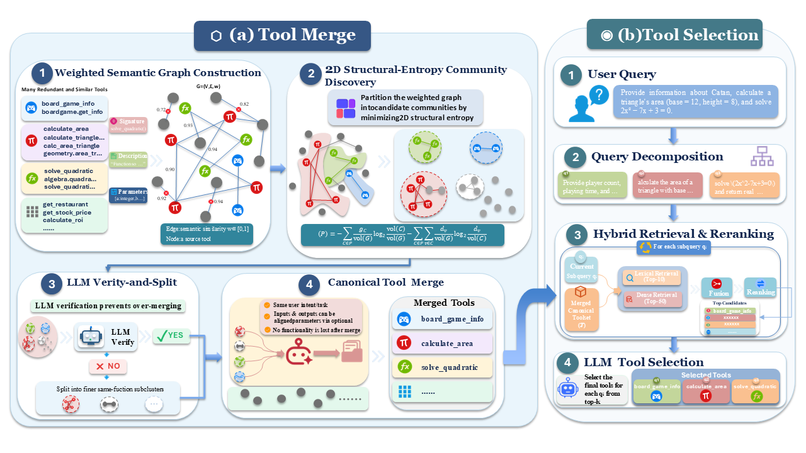

# EntroTool
As large language model (LLM) agents gain access to increasingly
extensive tool repositories, redundant functionality and overlapping
descriptions make accurate tool selection increasingly challenging.
Tool merging offers a promising solution by consolidating related
operations into unified interfaces, thereby reducing the number
of tools exposed to LLM agents. However, existing approaches
often group semantically equivalent operations based on graph
connectivity, where indirect connections may lead to overly broad
groups that obscure functional distinctions among tools. To address
this limitation, we propose **EntroTool**, a **structural entropy-guided**
framework for tool merging and selection. By minimizing structural
entropy over a weighted tool graph, EntroTool identifies coherent
tool groups that account for both internal connectivity and group
boundaries. Each group is subsequently consolidated into a unified
tool interface, while a hybrid retrieval mechanism selects relevant
merged tools for downstream execution. Experiments across three
benchmark-derived collections and three LLM selectors demonstrate consistent improvements over competitive baselines.




## 1. Prepare the environment

```bash
conda create -n entrotool python=3.10 -y
conda activate entrotool
pip install -r requirements.txt
```


```text
workspace/
├── EntroTool/
│   ├── config.json           # Model settings and run parameters
│   ├── prompts/              # LLM prompts
│   ├── src/entrotool/        # Python package
│   ├── scripts/              # Experiment entry points
│   ├── run.py                # General entry point
│   ├── run_merger.py         # Cluster entry point
│   
│   
└── datasets/                 # Download and Standardize
    ├── BFCL/
    │   ├── BFCL_osa.json     # 400 tools
    │   └── BFCL_v.json       # 400 queries
    ├── BFCL_PM/
    │   ├── BFCL_pm_osa.json  # 482 tools
    │   └── BFCL_pm_v.json    # 200 queries
    └── SealTool/             # Random selection
        ├── SealTool_osa.json # 1,034 tools
        └── SealTool_v.json   # 654 queries
```

[BFCL](https://github.com/ShishirPatil/gorilla/tree/main/berkeley-function-call-leaderboard):
use `BFCL_v4_simple_python.json` 

[BFCL_PM](https://github.com/ShishirPatil/gorilla/tree/main/berkeley-function-call-leaderboard): use `BFCL_v4_parallel_multiple.json` 

[Seal-Tools](https://github.com/fairyshine/Seal-Tools) our  experiments use a
random subset of 1,034 of its 4,076 tools and 654 questions. 


Each `*_osa.json` is a JSON array of tool objects; each `*_v.json` is a
separate JSON array of query records.

**BFCL** (single-tool queries):

`BFCL_osa.json`:

```json
[
    {
        "name": "calculate_triangle_area",
        "description": "Calculate the area of a triangle given its base and height.",
        "arguments": {
            "type": "dict",
            "properties": {
                "base": {
                    "type": "integer",
                    "description": "The base of the triangle."
                },
                "height": {
                    "type": "integer",
                    "description": "The height of the triangle."
                },
                "unit": {
                    "type": "string",
                    "description": "The unit of measure (defaults to 'units' if not specified)"
                }
            },
            "required": ["base", "height"]
        }
    }
]
```

`BFCL_v.json`:

```json
[
    {
        "id": "simple_python_0",
        "query": [
            [
                {
                    "role": "user",
                    "content": "Find the area of a triangle with a base of 10 units and height of 5 units."
                }
            ]
        ],
        "solution": ["calculate_triangle_area"]
    }
]
```

**BFCL_PM** (multi-tool queries):

`BFCL_pm_osa.json`:

```json
[
    {
        "name": "math_toolkit.sum_of_multiples",
        "description": "Find the sum of all multiples of specified numbers within a specified range.",
        "arguments": {
            "type": "dict",
            "properties": {
                "lower_limit": {
                    "type": "integer",
                    "description": "The start of the range (inclusive)."
                },
                "upper_limit": {
                    "type": "integer",
                    "description": "The end of the range (inclusive)."
                },
                "multiples": {
                    "type": "array",
                    "items": {"type": "integer"},
                    "description": "The numbers to find multiples of."
                }
            },
            "required": ["lower_limit", "upper_limit", "multiples"]
        }
    }
]
```

`BFCL_pm_v.json`:

```json
[
    {
        "id": "parallel_multiple_0",
        "query": [
            [
                {
                    "role": "user",
                    "content": "Find the sum of all the multiples of 3 and 5 between 1 and 1000. Also find the product of the first five prime numbers."
                }
            ]
        ],
        "solution": [
            "math_toolkit.sum_of_multiples",
            "math_toolkit.product_of_primes"
        ]
    }
]
```

**SealTool** (multi-tool queries):

`SealTool_osa.json`:

```json
[
    {
        "name": "analyzeEvidence",
        "description": "Analyze the chemical evidence collected from a crime scene",
        "field": "Chemical Engineering/Forensic engineering",
        "arguments": {
            "type": "object",
            "properties": {
                "evidence_type": {
                    "type": "str",
                    "description": "The type of evidence to be analyzed (e.g., DNA, fingerprints, blood, fibers)"
                },
                "method": {
                    "type": "str",
                    "description": "The method or technique to be used for analysis (e.g., spectroscopy, chromatography, microscopy)"
                },
                "sample": {
                    "type": "str",
                    "description": "The sample or specimen to be analyzed (e.g., crime scene swab, hair strand, fabric sample)"
                }
            }
        }
    }
]
```

`SealTool_v.json`:

```json
[
    {
        "query": "Tell me the details of the film \"Pulp Fiction\".",
        "solution": ["getFilmDetails"]
    }
]
```

## 2. Configure models

Edit [config.json](config.json) before running.

### Embedding and reranking

Download the models and set these fields to their  directories.

| Configuration field                     | Model                   | Used in          |
| --------------------------------------- | ----------------------- | ---------------- |
| `merger.semantic_graph.embedding_model` | `gte-large`             | Step 1: clusters |
| `retriever.embedding_model`             | `gte-large`             | Step 3: query    |
| `retriever.reranker_model`              | `ms-marco-MiniLM-L6-v2` | Step 3: query    |

### LLM stages

Each entry in `llms` can independently use a local model or an
API. Keep the following IDs unchanged:

| Step          | LLM ID                                                                                        |
| ------------- | --------------------------------------------------------------------------------------------- |
| Step 1 | `merge_autocorrection`  |
| Step 2 | `documentation_merger` |
| Step 3 | `query_decomposer` for multi-tool datasets                                  |
| Step 4 | `tool_selection`                                                                         |

**Local Model.** Set `model_path` to the downloaded model directory.

```json
{
    "id": "query_decomposer",
    "enabled": false,
    "provider": "local_transformers",
    "model": "gemma-4-E4B-it",
    "model_path": "/path/to/gemma-4-E4B-it",
    "device_map": "auto",
    "torch_dtype": "bfloat16",
    "enable_thinking": false,
    "max_tokens": 10000
}
```

**API Serve.** Replace the entry with the following format, using a model
name and endpoint supported by your API service:

```json
{
  "id": "query_decomposer",
  "enabled": false,
  "provider": "openai_compatible",
  "model": "gpt-6",
  "base_url": "https://api.openai.com",
  "api_key_env": "MODEL_API_KEY",
  "max_tokens": 10000
}
```

```bash
export MODEL_API_KEY="xxxxxx"
export MERGE_QUALITY_API_KEY="xxxxxx"
```


## 3. Run 


### Step 1: Generate clusters


```bash
python3 -B run_merger.py --dataset BFCL --dataset-root ../datasets \
  --output-root outputs/test/clusters
```

Output: `outputs/test/clusters/BFCL/connected_components.json`.

### Step 2: Merge clusters


```bash
python -B scripts/run_staged_pipeline.py --dataset BFCL \
  --components outputs/test/clusters/BFCL/connected_components.json \
  --merge-only --merge-concurrency 5 \
  --output outputs/test/merge/BFCL --resume
```

### Step 3: Evaluate queries


```bash
python -B scripts/run_staged_pipeline.py --dataset BFCL --query-only \
  --queries ../datasets/BFCL/BFCL_v.json \
  --merge-cache outputs/test/merge/BFCL \
  --output outputs/test/query/BFCL \
  --query-concurrency 1 --selection-concurrency 1 \
  --selection-retries 5 --resume
```

Output: `outputs/test/query/BFCL/summary.json` and `queries.jsonl`.

### Step 4: Judge merged tools


```bash
python -B scripts/evaluate_merged_tools.py --dataset BFCL \
  --merge-file outputs/test/merge/BFCL/clusters.jsonl \
  --output outputs/test/merge/BFCL/merge_quality_judgments.jsonl \
  --model-id merge_quality_judge --concurrency 5 --retries 3 --resume
```


